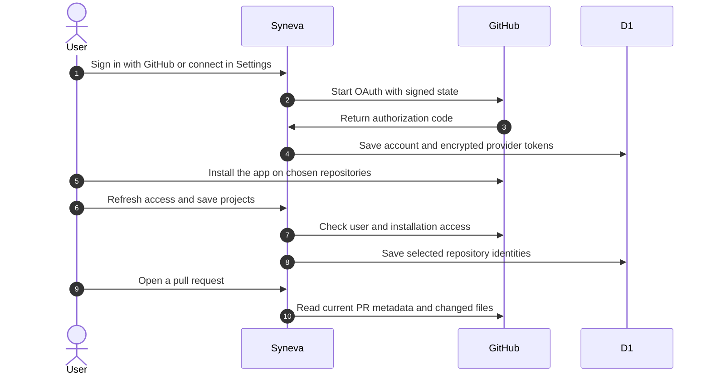

# GitHub connection

Syneva uses Better Auth with Cloudflare D1 for accounts and sessions. A GitHub App supplies both GitHub sign-in and access to the repositories its owners choose.



## Register the GitHub Apps

Register separate development and production Apps under NextNodeSolutions. These links prefill the registration forms, including permissions. Choose a globally available name if GitHub reports a name conflict.

- [Register the development App](https://github.com/organizations/NextNodeSolutions/settings/apps/new?name=Syneva%20Development&url=https%3A%2F%2Fdev.app.syneva.dev&callback_urls%5B%5D=http%3A%2F%2Flocalhost%3A5173%2Fapi%2Fauth%2Fcallback%2Fgithub&callback_urls%5B%5D=https%3A%2F%2Fdev.app.syneva.dev%2Fapi%2Fauth%2Fcallback%2Fgithub&request_oauth_on_install=false&setup_url=https%3A%2F%2Fdev.app.syneva.dev%2Fsettings&setup_on_update=true&public=true&webhook_active=false&contents=read&pull_requests=write&actions=write&emails=read).
- [Register the production App](https://github.com/organizations/NextNodeSolutions/settings/apps/new?name=Syneva&url=https%3A%2F%2Fapp.syneva.dev&callback_urls%5B%5D=https%3A%2F%2Fapp.syneva.dev%2Fapi%2Fauth%2Fcallback%2Fgithub&request_oauth_on_install=false&setup_url=https%3A%2F%2Fapp.syneva.dev%2Fsettings&setup_on_update=true&public=true&webhook_active=false&contents=read&pull_requests=write&actions=write&emails=read).

Keep **Request user authorization during installation** disabled. Authorization starts from Syneva, where Better Auth creates and validates OAuth state. A callback started by installation alone has no Syneva state and cannot finish sign-in. The setup URL returns the installer to Settings.

The App needs these permissions:

| Permission | Access | Purpose |
| --- | --- | --- |
| Repository contents | Read | Read pull request code |
| Pull requests | Read and write | Read PRs and permit review publication |
| Actions | Read and write | Read and permit workflow execution |
| Account email addresses | Read | Identify the GitHub account for sign-in |
| Repository metadata | Read | GitHub adds this required permission |

Enable installation on other accounts so users can choose personal and organization repositories. Disable webhooks because access is refreshed through GitHub's API. Keep user-token expiration enabled so Better Auth can refresh expiring tokens.

Review publication and workflow execution require the listed grants. Their user actions are separate features. This integration opens and reads pull requests.

## Add the App credentials

Use the existing Infisical project `syneva`, with the development App in `dev` and the production App in `prod`. Keep values at each environment's root. Never paste a client secret into chat or commit it.

| Name | Source |
| --- | --- |
| `BETTER_AUTH_SECRET` | App-owned signing and encryption secret. Preserve it across deployments to keep stored tokens readable. |
| `GITHUB_CLIENT_ID` | The App's Client ID, starting with `Iv` |
| `GITHUB_CLIENT_SECRET` | Generate a client secret in the App's settings |
| `GITHUB_APP_SLUG` | The exact slug in the App's public GitHub URL |

The Client ID and slug are public identifiers, delivered through the same runtime configuration as the credentials. No App private key or installation-token credential is required. Syneva uses user access tokens, so repository access must belong to both the user and the App installation.

Use independent `BETTER_AUTH_SECRET` values in `dev` and `prod`, preserving an existing value when present. The provider-issued values must come from the Apps you register. An ordinary OAuth App cannot replace a GitHub App because it does not supply selected repository installations.

The CI identity must have Viewer access to this Infisical project. An organization administrator must activate the intended `github-actions` identity in the organization containing `syneva`, then grant it Viewer access. The organization variable `INFISICAL_IDENTITY_ID` must refer to that identity. Keep the existing project and its secrets.

## Run locally

Authenticate your Infisical CLI account and ensure it belongs to `syneva`. The committed `.infisical.json` selects that project.

```sh
pnpm install --frozen-lockfile
pnpm --filter @syneva/dashboard db:local
pnpm dev:dashboard
```

`pnpm dev:dashboard` runs the dashboard's persistent development task through Turbo. Its package script loads credentials from `dev` at `/` and local settings from `/local` through Infisical, and enables Cloudflare to read the injected environment. Set `SITE_URL` to the browser's exact origin in `/local`, then open that URL. The local server listens on port 5173. Keep the preview URL in `/local` because deployment reads only `/` and generates its own `SITE_URL`.

Better Auth accepts only the configured origin. Add `<SITE_URL>/api/auth/callback/github` to the development App's callback URLs for GitHub sign-in. A different browser origin gets `Invalid origin`. GitHub allows one Setup URL per App, so point the development App's Setup URL at `<SITE_URL>/settings` while you develop locally, otherwise GitHub returns you to the deployed development site after installation. Keep secret values in Infisical. A pre-existing `.dev.vars` file prevents process-environment injection and must be reconciled before this command can supply the credentials.

Create an email/password account to connect an existing Syneva identity in Settings, or use **Continue with GitHub** to create or enter an account directly. Accounts are linked explicitly. A matching email address does not silently merge accounts. Email/password sign-in has no password-reset or email-verification delivery flow.

After signing in, open Settings, choose repositories on GitHub, return to Syneva, select **Refresh access**, select the projects, and save. An organization owner may need to approve installation. Removing installation or repository access takes effect on the next request.

Run the landing separately with `pnpm dev:site`.

## Deploy through CI

The dashboard uses `apps/dashboard/nextnode.toml`, separate from `apps/landing/nextnode.toml`. Its D1 migrations must never run against the landing signup database.

Run **Deploy dashboard development**, then **Deploy dashboard production** on the same revision. Both workflows are manually dispatched. The shared NextNode pipeline provisions the database, applies migrations, builds and deploys the Worker, and syncs the environment's vault secrets. Production requires a successful development deployment of that revision. No cloud resource has to be created by hand.

The workflows require the GitHub App credentials and the vault identity membership described above. A successful local account flow does not prove GitHub OAuth, organization installation, or deployed secret propagation. Check those after registration and the first CI deployment.

## Access and failure behavior

Repository choices belong to the signed-in Syneva user. Each read checks the user's current GitHub installations and available repositories before using saved choices. The browser receives repository metadata and diff content, never OAuth access or refresh tokens.

Files without a text patch remain visible with an explanation. A PR that changes while loading must be refreshed. If GitHub cannot return every changed file, Syneva refuses the incomplete diff and directs the reviewer to GitHub. Decisions and guided review are separate from reading a PR.

| Failure | What remains |
| --- | --- |
| OAuth denied or credentials missing | The existing Syneva account remains usable through its existing sign-in method. |
| GitHub token revoked or refresh denied | The account and project choices remain, with a request to reconnect GitHub. |
| Repository access removed | The inaccessible repository cannot be opened through its saved URL. |
| Project save rejected | The previous saved selection remains. |
| GitHub temporarily unavailable or rate limited | The request fails visibly and can be retried. |
| Deployment not run | Local behavior is available, while cloud provisioning and secret propagation remain unverified. |
