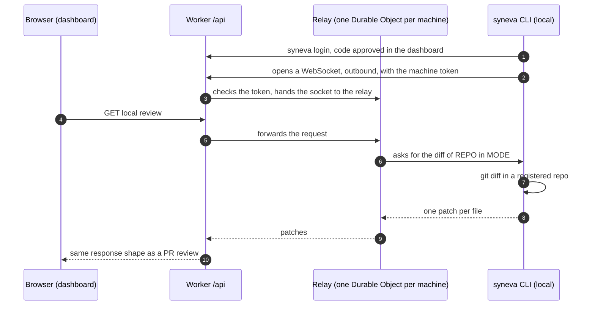
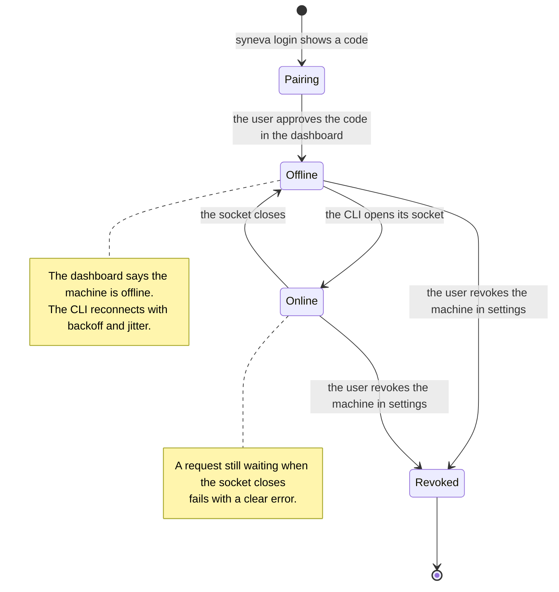

# Local connections

This page is the design for reviewing code that is on a developer's machine and not in a GitHub pull request: working-tree, staged and branch diffs. Stage 2 of the restart builds from it, and the root [`AGENTS.md`](../AGENTS.md) says when that stage starts.

Claude Code on the web never connects to your machine. The process on your computer connects out to Anthropic's server, and that server passes messages between it and the browser. Syneva uses the same pattern.

## How Claude Code does it

It has two separate modes:

1. **Cloud sessions**, the default at claude.ai/code. Anthropic copies your repo from GitHub into a virtual machine it runs, works there and pushes a branch. Your local machine isn't involved at all. Syneva's GitHub pull request reviews work the same way.
2. **Remote Control**, started with `claude remote-control` or `/remote-control`. The Claude Code process on your machine sends only outbound HTTPS requests. It registers with the Anthropic API and polls for work. When you open the session in a browser, Anthropic's server passes messages between the page and the local process over a streaming connection. No port is opened on your machine and there's no tunnel. Commands and file access stay local, and the login credentials are short-lived, each limited to one purpose. The source is the "Connection and security" section of [Remote Control](https://code.claude.com/docs/en/remote-control).

The browser never talks to `localhost`. The local process connects out, and the server relays.

## The same pattern for Syneva

A **machine** is a developer's computer that its owner paired with their Syneva account. The **relay** is the Durable Object that holds one machine's connection. The Worker checks the machine token before it hands the socket over, so the relay never holds an unauthenticated connection.

How it fits the code:

- **Local diffs are a second `ReviewSource` adapter** in the dashboard Worker's source layer. It forwards requests to the machine's relay, and the routes and use cases stay as they are. This is the slot the root `AGENTS.md` keeps for stage 2.
- **The messages between the Worker and the CLI are schemas in `@syneva/contracts`.** That covers requests, responses and online/offline status, and both sides import them.
- **One relay per machine keeps the CLI's WebSocket open.** It accepts the socket through Cloudflare's WebSocket Hibernation API, so an idle connection costs nothing, and it knows whether the machine is online.

## What makes it work properly

A paired machine rests in Offline whenever its CLI isn't running, so every screen and every request has to handle that state.

- **Pairing.** `syneva login` shows a code, and the signed-in user approves it in the dashboard. The Worker then issues a machine token, stores it hashed in D1, and the user can revoke it in settings. Never send the GitHub token to the machine.
- **Few allowed requests.** The CLI answers only fixed read-only requests: list the registered repos, get a working-tree, staged or branch diff, and read one file at a given revision. It refuses any path outside a registered repo, so a breach of the website can't become shell access on the laptop.
- **Offline is a normal state.** The dashboard shows "machine offline" instead of loading forever. Requests time out with the contract's error body, and the error says what fixes it.
- **Reconnection.** The CLI reconnects with backoff and random jitter. When the CLI disconnects, any request still waiting fails with a clear error.
- **Large diffs.** Send one message per file, not the whole diff at once, because WebSocket messages have a size limit.
- **Privacy.** The code passes through the Worker. By default, store only the verdicts and content hashes in D1, never the code.
- **The agent side.** `syneva await` and `reload` also send outbound HTTPS to the Worker, so nothing on the machine listens on a port.

## Why not the alternatives

| Option | Problem |
| --- | --- |
| Hosted page calls `http://localhost:PORT` directly | Chrome asks the user for "Local Network Access" permission, it needs CORS, browsers differ, and it can't work from a phone. |
| Local hub serving the interface, the archive's design | It works on one machine, but reaching it from another device needs the access key and opening the hub to the network. That's the design the restart dropped. |
| A tunnel per user, such as cloudflared or ngrok | One more tool to install, and a public URL per laptop that has to be secured. |

## Why a Durable Object

A Worker keeps nothing in memory between two requests, so the browser's request and the CLI's connection cannot meet inside a plain Worker. A Durable Object is the one piece of the Workers platform that holds a socket between requests. The design could do without one, but each way of doing so is worse here:

| Without a Durable Object | Problem |
| --- | --- |
| The CLI polls the Worker, with D1 as the queue | Every connected machine reads the database in a loop, all day, and each answer waits for the next poll. This is the same shape as the loop behind the bill described below. |
| A relay server outside Cloudflare, a small always-on Node process | A flat price with no usage billing, but a second deployment target, and sign-in has to be checked in two systems. |
| A hosted pub/sub service | One more vendor holding the code in transit. |

The relay server outside Cloudflare stays the fallback. The relay sits behind the `ReviewSource` adapter and the contract, so swapping it touches one module.

## What the relay costs

Durable Objects have a reputation for surprise bills. This section says where such a bill came from, and which rules keep the relay away from it.

[The Cloudflare bill on serverlesshorrors](https://serverlesshorrors.com/all/cloudflare-108k/) came from a Durable Object alarm that rescheduled itself forever and read and wrote storage on each run. The bill was storage operations, on a paid plan with no hard spending limit. No WebSocket was involved.

Each rule below follows from how Cloudflare bills a Durable Object. The rates are on Cloudflare's [pricing page](https://developers.cloudflare.com/durable-objects/platform/pricing/), and the socket behavior is in its [WebSocket best practices](https://developers.cloudflare.com/durable-objects/best-practices/websockets/).

- **Accept the socket through the Hibernation API only.** Cloudflare bills duration while an object is awake, and nothing while it is idle and able to hibernate. A socket accepted through the Hibernation API lets the object sleep while the CLI stays connected. A socket accepted the standard way keeps the object awake, and billed, for the whole connection.
- **Set no alarm and no repeating timer.** Alarms, timers and intervals stop an object from hibernating. The only timer is a request's deadline, and it ends with that request.
- **Keep keepalives out of the relay's code.** Cloudflare's runtime answers protocol pings without waking the object, and does not bill them. The runtime's auto-response pair does the same for an application-level ping.
- **Write nothing to storage per message.** Storage writes are the expensive dimension, and the one behind the bill above. The Worker's use cases write verdicts when the human acts. Traffic writes nothing.
- **Let the CLI send only answers to requests.** Incoming socket messages count as requests, at a reduced ratio, and outgoing messages are free. The relay closes a socket that sends anything else, and bounds the message rate per socket.
- **Bound the fan-out.** One relay per machine and one socket per relay, where a new connection replaces the old one, plus a cap on machines per account.
- **Set a budget alert before stage 2 ships.** On the free plan, going over a limit makes operations fail instead of billing. On the paid plan there is no spending cap. A [budget alert](https://developers.cloudflare.com/billing/manage/budget-alerts/) sends an email when spend crosses a threshold, and does not stop anything. Set one on the Cloudflare account that runs the dashboard.

For scale, one object kept awake for a whole month fits inside the paid plan's included duration. The realistic failure is many machines connected with hibernation broken, and that costs a few dollars per machine per month. A bill in the thousands takes a loop that writes storage, which is what the rules above forbid.

Cloudflare changes its billing over time. Re-read the two Cloudflare pages before building the relay, and correct this page in the same change when a rule has moved.
