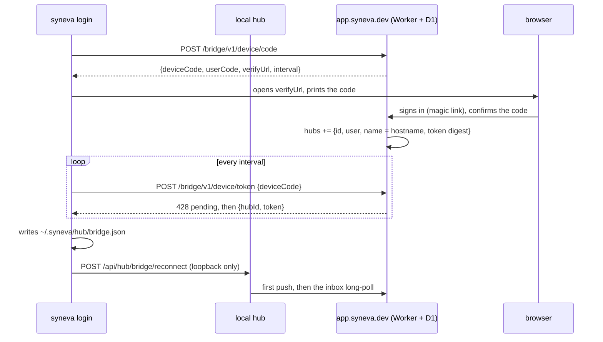
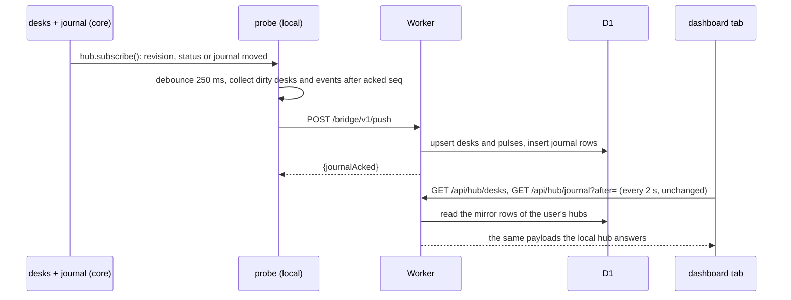

# RFC 0001 · Core, web, local: one hub, two ways in

Status: proposal, nothing implemented. Date: 2026-10-20. Branch: `worktree-bridge-*`.

This RFC answers three questions in order: how Syneva works today, how the workspace splits
into a core, a local runtime and a web service, and how a local hub shows up on syneva.dev in
real time without Durable Objects. Prices and limits quoted are Cloudflare's as published in
October 2026 (Workers, D1, R2, Queues, Durable Objects pricing and limits pages).

## 1. How the app works today

### 1.1 One process, two surfaces, one protocol

- **The hub** (`packages/backend/src/bootstrap/hub.ts`) is one `node:http` server per machine
  on port 4747. `createHubRequestHandler` (`adapters/inbound/http/router.ts`) is the single
  request entry point: Host/Origin guard, then the access guard (`--key`, Bearer header or
  signed-in cookie), then dispatch: dashboard page shells, desk page shell, hub API
  (`/api/hub/*`), dashboard API (journal, settings), per-desk API (`/api/desks/<id>/*`, 22
  routes in `routes.ts`), UI assets last.
- **The desk registry** (`adapters/inbound/http/hub.ts`, `createHub`) is a `Map<deskId, HubDesk>`.
  Opens are serialized. A desk id is `hash(root + "\n" + session)` (`domain/identity.ts`), so an
  open is idempotent and `/d/<id>/` survives a restart; the rebuild parameters are persisted to
  `~/.syneva/hub/desks.json` and `restore()` rebuilds every desk at start, before the server
  answers desk requests.
- **One hosted desk** (`hosted-desk.ts`, `context.ts`): a `DeskContext` holds a copy-on-write
  `ReviewState`, a monotonic `revision`, one mutation mutex, the agent event stream
  (`application/events.ts`: question / review / closed, FIFO, one parked waiter), the ephemeral
  agent activity (90 s TTL), liveness, the capability ports (git, store, settings, editor) and
  the journal binding that names the desk on every event.
- **The review itself** is pure domain/application code over `GitPort` (`application/build.ts`
  assembles the diff and reads contents through `git cat-file --batch`; reconcile, staging,
  send, guide drafting and composition are all pure over the ports), persisted as JSON under
  `~/.syneva/<repoHash>/<session>/`.
- **The journal** (`application/journal.ts` on `HubJournalPort`, `~/.syneva/hub/journal.jsonl`)
  records an event when the thing happens and serves its tail (5000 kept, reads capped at 2000).
- **The published package** (`apps/syneva`) bundles the backend entry and the pi bridge with
  tsdown and copies the built UI next to them; the pi extension under `extension/` is an
  adapter over the same CLI/HTTP contract (`syneva spec`).

### 1.2 Who talks to the hub, and how often

| Caller | Transport | Cadence |
|---|---|---|
| Desk tab (`ui.js`) | `GET /api/desks/<id>/poll?instance=` | every 1.5 s (`app/poll.ts`); `/state` only when `baseDiffHash` moves; `/file-contents` per file, on demand |
| Dashboard (`dashboard.js`) | `GET /api/hub/desks`, `GET /api/hub/journal?after=` | every 2 s while the tab is visible (`entities/hub/poll.ts`); health once |
| Agent, CLI | `GET /api/desks/<id>/await-send` | one long-poll parked up to 1 h; `comment`, `status`, `reload`, `close` are plain requests |
| Agent, pi | the same routes through `adapters/inbound/pi` | the listener rides out a hub restart |
| Reviewer | `POST /save`, `/send`, `/ask`, `/reset`, `/stage*`, `/open-editor` | on action |

There is no WebSocket and no SSE anywhere today: everything is polling plus one long-poll.
That is good news for a bridge: the frontend already tolerates latency and a server with no
connection state.

### 1.3 What is portable and what is Node-bound

| Layer | Node coupling | Verdict |
|---|---|---|
| `domain/`, `application/` | only `node:path` and `node:crypto` (sha1, sha256, randomUUID); no third-party dependency | portable as is: both modules exist on Workers under `nodejs_compat` |
| `adapters/inbound/http/*` | `IncomingMessage` / `ServerResponse` in every route; `res.on('finish')` hooks on send, stop, shutdown | the one real blocker: must move to Fetch `Request` / `Response` |
| `adapters/outbound/*` | `node:fs`, `child_process` (git, gh, the editor), `oxc-parser` native binding | local by nature |
| `adapters/inbound/cli`, `adapters/inbound/pi`, `bootstrap` | `process`, spawn, lock files | local by nature |
| `packages/frontend` | none: the desk id comes from the page URL, every path from `@syneva/contracts/routes` | portable as is |
| `packages/contracts` | none | shared |

### 1.4 What already points at a hosted hub

- `--host`, `--key`, `--public-url` bind the hub wider behind an access key (README, "Reviewing
  from another machine"). The bridge does not replace this: a tailnet user can keep it.
- The unmerged `feat/agent-runner` branch parks one desk's event loop in a plain process
  (`syneva runner --exec`). The README roadmap lists "Remote runners" and "Hosted hub".
- `PRODUCT.md`: two ways in, one product; features that need a server of ours belong to the
  hosted service alone; the local hub never needs an account.

## 2. Goals, non-goals, constraints

Goals

1. The same experience local and web: same dashboard, same desks, same routes, same bundle.
2. A hub on a laptop shows up on syneva.dev in real time, from any device, when its owner signs in.
3. The web stays minimal: accounts, pairing, a mirror, a relay. No review logic.
4. The web can later host things the local never will (cloud agents, history, sharing).
5. The local never needs an account: no pairing, no bridge, nothing changes.

Constraints

- No Durable Objects. The transport is a port so that decision can be revisited without a rewrite.
- The agent contract (`syneva spec`), the desk routes and the review files on disk stay as they are.
- Everything deploys the way the landing does: Workers, D1, CI only, `nextnode.toml`.

Non-goals (this RFC)

- Multi-user review of one desk, sharing, comments from a second person.
- Hosting desks in the Worker itself (see 3.3: a cloud agent is a hub in a sandbox).

## 3. The split

### 3.1 Package map

```
packages/contracts    wire shapes (+ bridge.ts)                            shared, no deps
packages/core         domain + application + the hub + the http protocol   runs on Node and on Workers
packages/frontend     the surface: desk + dashboard (unchanged)            runs in the browser
packages/local        Node adapters, the http server, the CLI, pi, probe   Node only
apps/syneva           the published CLI: bundles local + core + frontend
apps/web              the SaaS Worker: accounts, pairing, mirror, relay    Workers only
apps/landing          unchanged
```

Dependency rule, enforced by oxlint: `core` and `frontend` import nothing from `local` or
`web`; `local` and `web` import `core` and `contracts`; `frontend` imports `contracts` only.
The core's only `node:*` imports are `node:path` and `node:crypto` (both available on Workers
under `nodejs_compat`); `node:fs`, `node:http`, `node:child_process`, `node:os` and the
`process` global are refused in core by a `no-restricted-imports` / `no-restricted-globals`
override with a stated reason.

"A core that embeds all the functioning" is two build units, `core` (the engine) and
`frontend` (the surface), because of the two compilation worlds (`AGENTS.md`). One product.

### 3.2 What moves where

`packages/core` (from `packages/backend`):

- `domain/**` and `application/**` as they are.
- The http protocol rewritten on the Fetch API: `router.ts`, `routes.ts`, `routes/*`,
  `hub.ts`, `hosted-desk.ts`, `context.ts`, `liveness.ts`, `hub-routes.ts`, `hub-records.ts`,
  `hub-desks.ts`, `hub-inventory.ts`, `open-request.ts`, `reviewer-save*.ts`, `failure.ts`,
  `pages.ts`, the pure half of `binding.ts`, the digest half of `auth.ts`. `RouteRequest`
  becomes `{ ctx, request: Request, url }` and a handler returns a `Response`. The hooks that
  run once the response has flushed (the `review` event after `/send`, the close after
  `/shutdown` and `/stop`) become `effects.afterResponse(fn)`, run by the server adapter.
  The `/await-send` long-poll is a `Response` whose promise settles on the event or the timeout.
- A new `hub.subscribe(listener)`: the hub tells what moved (a desk opened, reloaded, closed; a
  state commit; a status change; a journal event). Nothing observes the hub today; the probe
  will, and so will a future SSE route on the local hub.

`packages/local`:

- `adapters/outbound/**` (git, filesystem, editor, source, package-registry, console,
  platform-open), unchanged.
- A `node-server.ts` adapter: `IncomingMessage` to `Request`, `Response` to `ServerResponse`
  (streaming bodies), `afterResponse` effects on `finish`, the strict bind of `listen.ts`.
- `routes/static.ts` (reads the built bundle from disk), `adapters/inbound/cli/**`,
  `adapters/inbound/pi/**`, `bootstrap/**`.
- New: `adapters/outbound/bridge/**`, the probe (section 4), and `syneva login` / `logout`.

`apps/web/src`: section 5. It imports from core only what the dashboard half of the hub needs
(the journal, the summaries, the route constants, the page shells, the failure shapes) and
`@syneva/contracts/bridge`.

### 3.3 Three composition roots, one hub

```
local hub     core hub over node ports (git, review store, settings, editor, registry, journal)
              + the node http server + the probe when paired
web           core dashboard routes over D1 ports (mirror registry, mirror journal, user settings)
              + the relay for desk routes + accounts and pairing
sandbox hub   the local hub, inside a sandbox, paired with a token: a cloud agent, later
```

The decision that keeps the web minimal: **the web hosts no desk of its own**. A desk lives in
a hub, and a hub runs where the repository is: a laptop today, a sandbox tomorrow. A cloud
agent is a hub in a sandbox that pairs with the web exactly like a laptop does (`syneva login
--token`, non-interactive). The web needs no third kind of desk, ever, and the hub stays one
thing; "cloud agents" becomes provisioning plus pairing, which belongs to the web alone.

"The hub is the same local and web" then reads: the hub as the reviewer sees it (dashboard,
desks, routes, bundle) is the same; what answers differs: locally the registry and the desks in
process, on the web the mirror and the relay to the hubs that hold the desks.

## 4. The bridge

### 4.1 Four principles

1. **Outbound only.** The hub connects to the web; the web never connects to the hub. No open
   port, no tunnel binary, works behind NAT and on a phone. This is the Claude Code remote
   control shape: a probe on the machine, a relay in the cloud, the same UI on top.
2. **Mirror what polls, relay what acts.** The browser's high-frequency reads
   (`/api/hub/desks`, `/api/hub/journal`, `/api/desks/<id>/poll`) are answered from a mirror the
   hub pushes on change. The reads a person triggers and every mutation are relayed to the hub,
   one request each.
3. **Wait inside one Worker invocation.** A Worker request costs $0.30 per million; a D1 row
   read costs $0.001 per million; an invocation may stay open as long as the client is
   connected and run up to 1000 D1 queries. So the relay parks inside one long-poll invocation
   that polls D1 every 250 ms, instead of asking the hub to call the web four times a second.
   This is what makes the design cheap without an addressable object in the cloud.
4. **The transport is a port on both ends**: `BridgeTransport` in local (push, pull inbox,
   answer), `Relay` in web (enqueue, await answer). A Durable Object relay could replace the D1
   mailbox later with no change to the hub, the UI or the contract.

### 4.2 Pairing: `syneva login`

A device-code flow, like `gh auth login`. The result is `~/.syneva/hub/bridge.json`
(`{ webUrl, hubId, token }`, mode 0600). The hub reads it at start; `syneva login` also pokes a
running hub through a loopback-only route so it connects at once. `syneva logout` revokes the
token on the web and deletes the file. The dashboard's Hub page shows the pairing on both sides.
No file means no probe: the local hub is exactly what it is today.



### 4.3 Hub to web: the push

Trigger: `hub.subscribe()`. The probe debounces 250 ms, collects what moved and posts it:

```
POST /bridge/v1/push            Authorization: Bearer <hub token>
{
  hub:     { version, instanceId, startedAt },
  desks:   DeskSummary[]                                   (changed desks only)
  closed:  deskId[]
  pulses:  { [deskId]: PollPayload & DeskStatus & { instanceId } }   (changed desks only)
  journal: HubEvent[]                                       (after the last acked seq)
  sentAt
}
->  { journalAcked: <hub seq> }
```

Idempotent by construction: desks and pulses are latest-wins per desk id, journal rows are
unique on `(hub_id, hub_seq)`, so a replay after a failure changes nothing. A heartbeat (an
empty push) every 30 s keeps `last_seen_at`; no heartbeat for 90 s reads as offline. When the
web is unreachable the probe keeps a dirty set, backs off (1 s to 60 s) and replays; a local
request never waits on the bridge, exactly as it never waits on a journal write.

A pulse is what `/poll` answers today (hash, guide, resolution, comments, threads, status): a
few KB, a few hundred KB on a big guided desk, pushed only when the revision or the status moved.



### 4.4 Web to hub: the inbox and the relay

**The inbox** is one long-poll per online hub: `GET /bridge/v1/inbox?wait=25`. Inside that
invocation the Worker polls `tunnel WHERE hub_id = ? AND state = 'pending'` every 250 ms while
the hub is watched (`hubs.watched_until > now`, refreshed at most every 10 s by any browser read
of that hub) and every 2 s otherwise, claims rows atomically (`UPDATE ... WHERE state =
'pending'`, D1 runs one query at a time per database) and answers `{ requests: [...] }`, or
`[]` at the deadline. The 1000-queries cap ends the invocation by itself; the hub loops.

**The relay**, for one browser request:

1. The browser calls `GET /api/desks/<webId>/state`. The Worker resolves `webId` to
   `(hub, deskId)`, checks the hub belongs to the signed-in user, inserts a `tunnel` row (body
   inline up to 1 MB, in R2 above; D1 rows are capped at 2 MB) and polls that row's state every
   200 ms, up to 30 s.
2. The hub's inbox call returns the request. The probe builds a trusted `Request` and
   dispatches it **in process** to the core router: no loopback HTTP, the Host/Origin guard
   skipped because the channel itself is authenticated, the path allowlist enforced on both
   ends. It posts the answer: `POST /bridge/v1/responses/<id>` with status, content type and
   body (R2 above 1 MB).
3. The waiting invocation sees `state = 'answered'`, returns the body to the browser and
   deletes the row. Past 30 s it answers 504 `HUB_TIMEOUT`; an offline hub gets 503
   `HUB_OFFLINE` at once, without a row.

Round trip: one inbox tick (up to 250 ms) + the hub's work + one response tick (up to 200 ms),
about 0.4 to 0.7 s. Opening a desk on the web costs the prefs (web), the state and the tree
(relay) and the first file's contents (relay): about 1 to 1.5 s to the first paint.

```mermaid
sequenceDiagram
    participant T as desk tab (web)
    participant W1 as Worker: browser request
    participant DB as D1 (+ R2 for big bodies)
    participant W2 as Worker: inbox long-poll
    participant P as probe (local)
    participant H as core router (in process)
    T->>W1: GET /api/desks/:webId/state
    W1->>DB: INSERT tunnel row, state = pending
    loop every 250 ms hot, 2 s idle, at most 25 s
        W2->>DB: claim pending rows of this hub
    end
    W2-->>P: {requests: [...]}
    P->>H: trusted Request on an allowlisted path
    H-->>P: Response
    P->>DB: POST /bridge/v1/responses/:id (another invocation writes the row)
    loop every 200 ms, at most 30 s
        W1->>DB: read the row's state
    end
    W1-->>T: the hub's answer; the row is deleted
```

**SSE or long-poll.** For the inbox the two cost the same and run the same Worker loop; the
long-poll needs no event-stream parser on the hub and no `Last-Event-ID` bookkeeping, so
phase 1 uses it. For the browser, SSE would turn one request every 2 s per tab into one
streaming request that polls D1 server-side at the same cadence: the same D1 cost, about six
times fewer Worker requests. That is the phase 3 optimization, not a prerequisite: the
frontend's polling works unchanged against the web from day one.

**Why not have the push answer carry the inbox** (one `sync` call per tick, no long-poll)? When
someone is watching, the hub would call the web four times a second: about 10 million requests
a month per hub, $3 each. The long-poll keeps the waiting inside one invocation where the
tick is a D1 read, a thousand times cheaper.

### 4.5 The hub API on the web, route by route

| Route | Local | Web |
|---|---|---|
| `GET /api/hub/health` | the process | the Worker: deploy id as `instanceId`, desks from the mirror, `keyRequired: false` (a session cookie signs in) |
| `GET /api/hub/desks` | the registry | the mirror: every desk of the user's hubs, each with `hub: { id, name, online }` |
| `POST /api/hub/desks` | open | relayed to the hub the body names (`hubId`; the New review dialog picks it) |
| `DELETE /api/hub/desks/<id>` | close | relayed |
| `POST /api/hub/inventory` | build | relayed |
| `GET /api/hub/journal` | the journal tail | the mirror: one seq per user, merged across hubs |
| `GET`/`POST /api/hub/settings`, `/api/desks/<id>/settings` | `~/.syneva/settings.json` | D1 `user_settings`: the prefs follow the user across devices |
| `GET /api/desks/<id>/poll` | the desk | the mirrored pulse: same `?instance=` check, same refresh event |
| every other `/api/desks/<id>/*` | the desk | relayed (`/await-send` excluded: an agent talks to its hub, never to the web) |
| `/login`, `/logout` | the key page | the magic-link page |
| pages and assets | the built bundle on disk | the same bundle as Worker static assets |

### 4.6 Ids, seqs, settings

- Web desk id: `hash(hubId + "\n" + deskId)`, 16 hex characters, so it fits `DESK_ID` and
  `/d/<id>/` unchanged; `path` is rewritten at ingest; `desks(web_id, hub_id, desk_id)` maps
  back. Two laptops with the same repo path and branch never collide.
- Journal: `journal(user_id, seq)` is monotonic per user; `(hub_id, hub_seq)` is unique. The
  dashboard's `after=` cursor and `latest` keep their meaning.
- `serverInstanceId` passes through the pulse: a restarted local hub shows the same refresh
  notice on the web as on the local tab.
- Settings are per user on the web and per machine locally; the contract is identical.

### 4.7 Offline and failure modes

- Hub offline: its desks stay listed, greyed, with "last seen"; a relayed request answers 503
  `HUB_OFFLINE` at once and the tab shows its existing "not answering" cover. Phase 3 can serve
  the last mirrored state read-only.
- Web unreachable from the hub: nothing local changes; the probe backs off and replays.
- Token revoked (401 on any bridge call): the probe stops; the Hub page says so.
- A reconnect race (two inbox invocations for one hub): atomic claims, a request is handed out
  at most once. No automatic retry of a relayed action (they are not idempotent); the person
  retries, as they would against a slow local hub.
- A Worker deploy mid-stream: the long-poll ends, the hub reconnects on its next loop.

### 4.8 Security and privacy

- Tenancy: every web route resolves a desk or a hub through the signed-in user's rows; there is
  no path from one user to another's hub.
- Hub token: 32 random bytes, stored as a sha256 digest, sent as a Bearer header on every bridge
  call, one per hub, revocable from the Hub page. Session cookies are `HttpOnly`,
  `SameSite=Lax`, `Secure`; mutations keep the same-origin rule the local hub has.
- Path allowlist on both ends, from `@syneva/contracts/routes`; the probe refuses anything else,
  so a compromised Worker still cannot make a hub do something a tab could not.
- The hub's in-process dispatch skips Host/Origin (the channel is authenticated) and keeps every
  per-route validation; it runs the editor, stages and resets exactly as a local tab can, so
  pairing is the same trust decision as `--key`, and the README says so in the same words.
- Transit: a relayed body rests in D1 or R2 between the hub's answer and the browser's read
  (seconds), deleted on delivery, swept by a cron after 60 s; encrypted at rest by Cloudflare.
  The mirror holds what the dashboard shows and nothing else. Phase 3: end-to-end encryption
  with a per-hub key held by the browser (the Worker relays ciphertext): the cloud cannot read
  your code. No telemetry, as today.
- The rate limiter binding guards sign-in, pairing and push, as it guards the signup today.

### 4.9 Cost and ceilings

Assumptions: Workers Paid ($5 a month, already paid for the landing; 10 million requests and 30
million CPU-ms included), prices as published in October 2026: requests $0.30 per million, CPU
$0.02 per million ms, D1 reads $0.001 per million rows (25 billion included), D1 writes $1 per
million rows (50 million included), R2 $4.50 per million writes and $0.36 per million reads.
One paired hub online 24/7, one dashboard tab and one desk tab open 8 h a day:

| Item | Volume per month | Cost |
|---|---|---|
| Inbox long-poll (25 s calls) | 104k requests; 1.3M D1 reads idle, +3.5M hot | $0.03 requests, $0.03 to $0.10 CPU |
| Pushes and heartbeats | 86k requests; under 100k rows written | $0.03 |
| Dashboard tab polling (2 reads every 2 s) | 864k requests | $0.26 + $0.03 CPU |
| Desk tab polling (1 read every 1.5 s) | 576k requests | $0.17 + $0.02 CPU |
| Relayed actions (about 100 a day) | 3k requests, 3k R2 ops at most | under $0.02 |
| **Total per active user** | | **about $0.35 to $0.65** |

Browser polling dominates; SSE for browser tabs (phase 3) brings it to about $0.10. The 10
million included requests absorb the first ten or so such users entirely. For reference, a
Durable Object with hibernating WebSockets would cost a few cents per user; the cost the
decision protects against is a bug, not the list price: one object kept awake 24/7 by a
non-hibernating connection costs about $4 a month, times however many objects are stuck. The
port in 4.1 keeps that option open without betting on it.

Ceiling: one D1 database runs one query at a time, about a thousand 1-ms queries a second.
The hot cadence (one read every 250 ms per watched hub, one read per browser poll) is
comfortable to roughly a hundred hubs watched at the same time plus their tabs. Past that:
500 ms hot ticks, a second D1 for the mailbox, or the Durable Object transport. Given
`PRODUCT.md`'s stance on adoption, that is a good problem to have.

### 4.10 Alternatives considered

- **Durable Object relay**: the textbook answer (in memory, no mailbox, no polling), set aside
  by decision; the transport port keeps it reachable.
- **cloudflared tunnel per hub**: no relay code at all, but a 30 MB binary dependency in the
  CLI, a public hostname per hub, and an account-level API token in the Worker to create
  tunnels. Rejected.
- **Browser to hub directly** when on the same machine (`https` page to `http://localhost`):
  Chrome's private-network-access prompts, useless from another device; at most a later fast path.
- **WebRTC data channel** (the Worker only signals): true peer to peer and end-to-end by
  construction, but some networks need TURN, which Cloudflare sells separately. Later, maybe.
- **Queues with HTTP pull consumers**: the pull token is an account-level API token that
  cannot be handed to users' hubs, and the pull does not long-poll. No gain over D1.

## 5. Contract, schema, routes

`packages/contracts/src/bridge.ts` (sketch):

```ts
export type BridgePush = {
  hub: { version: string; instanceId: string; startedAt: string }
  desks: DeskSummary[]
  closed: string[]
  pulses: Record<string, PollPayload & DeskStatus & { instanceId: string }>
  journal: HubEvent[]
  sentAt: string
}
export type BridgePushAck = { journalAcked: number }
export type TunnelRequest = {
  id: string
  method: 'GET' | 'POST' | 'DELETE'
  path: string          // /api/hub/... or /api/desks/<deskId>/... (allowlisted)
  query: string
  body?: string | { r2Key: string }
  deadlineAt: string
}
export type TunnelResponse = {
  status: number
  contentType: string
  body?: string | { r2Key: string }
}
export const BRIDGE_PATHS = {
  deviceCode: '/bridge/v1/device/code',
  deviceToken: '/bridge/v1/device/token',
  push: '/bridge/v1/push',
  inbox: '/bridge/v1/inbox',
  responses: '/bridge/v1/responses/',
} as const
```

D1 schema (`apps/web/migrations`):

```sql
users         (id, email, created_at)
sessions      (id, user_id, expires_at)
login_codes   (code_digest, email, expires_at)
device_codes  (device_code_digest, user_code, hub_id, user_id, approved_at, expires_at)
hubs          (id, user_id, name, token_digest, version, created_at, last_seen_at, watched_until, revoked_at)
desks         (web_id, hub_id, desk_id, summary_json, updated_at)
desk_pulses   (web_id, pulse_json, updated_at)
journal       (user_id, seq, hub_id, hub_seq, event_json, at)      -- unique (hub_id, hub_seq)
tunnel        (id, hub_id, state, request_json, body, r2_key, response_json, created_at, answered_at)
user_settings (user_id, settings_json, updated_at)
```

Bindings (`nextnode.toml`, a second service beside the landing, at `app.syneva.dev`): D1, an
R2 bucket with a one-hour lifecycle rule, the rate limiter, `nodejs_compat`, a cron every
minute (sweep `tunnel`, mark hubs offline), the static assets directory the build fills with
`packages/frontend/dist`. Secrets from the `syneva` Infisical project: `RESEND_API_KEY`
(shared), `SESSION_SECRET`.

Web routes: the bridge routes above (Bearer hub token), `/login` and `/auth/*` (magic link),
`/api/hub/*` and `/api/desks/*` as in 4.5 (session cookie), the dashboard and desk page shells,
the assets.

## 6. Frontend deltas

Small, and all in slices that already model the hub:

- `entities/hub/model.ts`: `HubDesk.hub?: { id, name, isOnline }`; project grouping and the
  desk cards show the hub name when there is more than one; an offline hub gets its own tone.
- The New review dialog takes a hub picker on the web (hidden with one hub).
- `entities/hub/api.ts` / `shared/api/client.ts`: nothing to add; the web answers the same
  paths. Two refusal codes map onto existing covers: `HUB_OFFLINE`, `HUB_TIMEOUT`.
- The Hub page shows the pairing (local: "connected to syneva.dev as ..."; web: the hubs,
  their versions, last seen, revoke).
- Sign-in on the web is its own page (magic link), in the same language as `pages.ts`.
- Nothing changes in the diff view, the render path, the guide pane or the agent loop.

## 7. Plan

Each phase ships on its own and ends with the hub smoke loop green (`AGENTS.md`, "Hub smoke");
phase 2 adds a web smoke: pair a scratch hub, open a desk on the web, send a round, read the
journal on both sides.

- **Phase 0, the split, no behavior change.** `packages/core`, `packages/local`; the http
  protocol on Fetch with the node server adapter; `hub.subscribe()`; the lint rules of 3.1;
  `apps/syneva` bundling from local. The published CLI behaves byte for byte as before.
- **Phase 1, the probe.** `contracts/bridge.ts`, `syneva login` / `logout`, the probe (push,
  inbox loop, in-process dispatch), the Hub page's pairing state. Testable against a stub web.
- **Phase 2, the web MVP.** `apps/web`: magic-link accounts, device pairing, ingest, inbox and
  relay, the mirror-backed hub API, the UI as static assets, the cron, the multi-hub labels in
  the dashboard, the deploy service. This is the first thing a person can sign in to.
- **Phase 3, the rest.** SSE for browser tabs, end-to-end encrypted relay bodies, offline
  read-only desks, sandbox hubs (cloud agents), history past the mirror.

Untouched throughout: `syneva spec`, the desk routes and their codes, the review files, the
journal file, the local workflow without an account.

## 8. Open questions

- `app.syneva.dev` as a separate Worker (recommended: the landing stays static and public, the
  app is authenticated) or a route under `syneva.dev`.
- Sign-in: magic link only at first (Resend is wired), GitHub OAuth later if PR desks want it.
- Naming: `packages/core` and `packages/local` (this RFC), or keep `backend` and add `local`.
- Whether `node:path` in core should become a posix-only helper now (a Windows root's
  `basename` on a Worker is wrong) or when the first Windows hub pairs.
